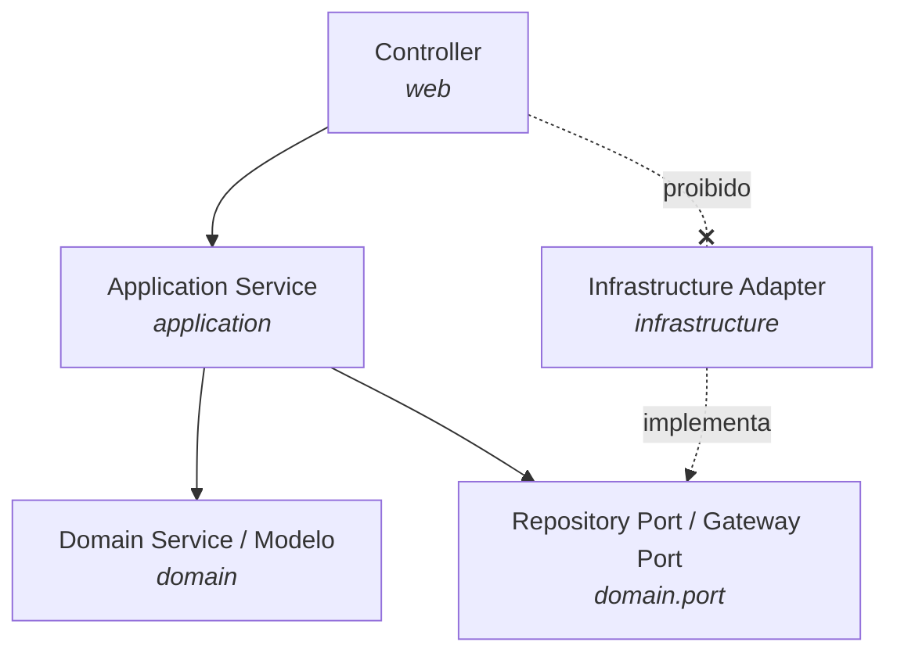
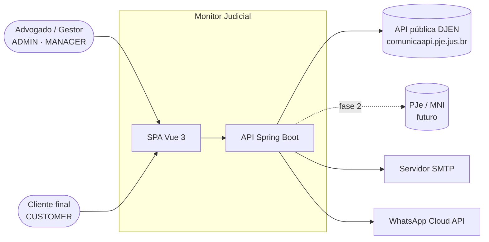
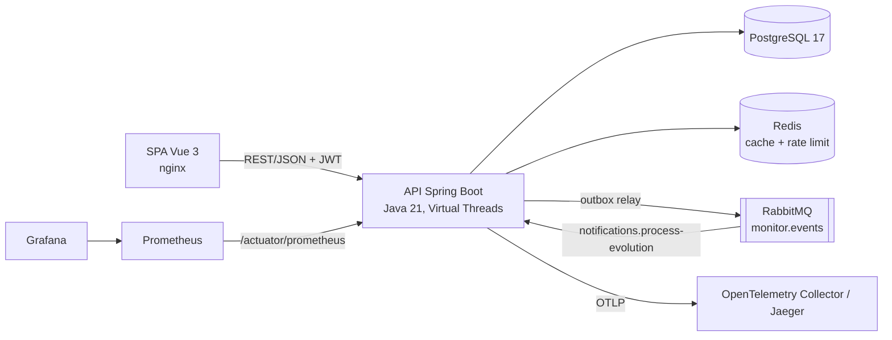
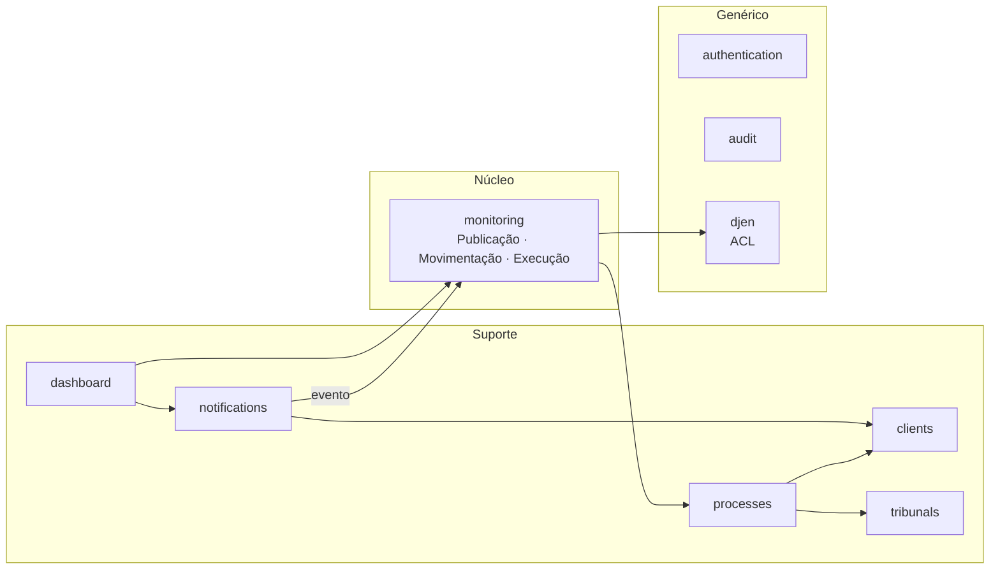
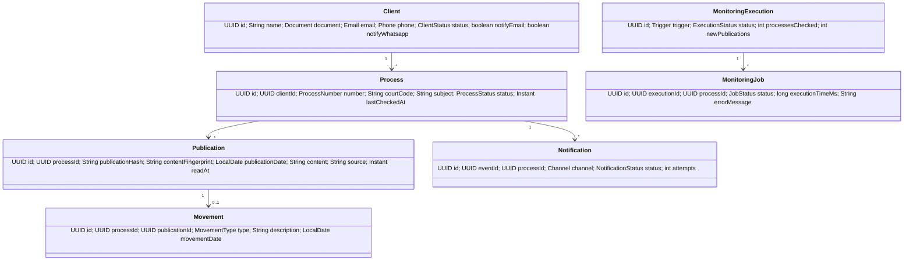
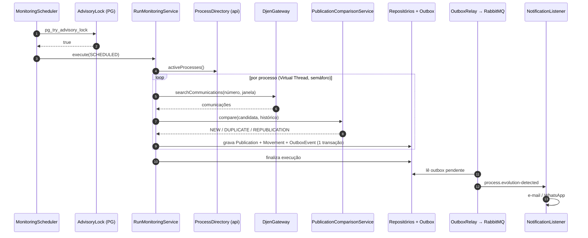
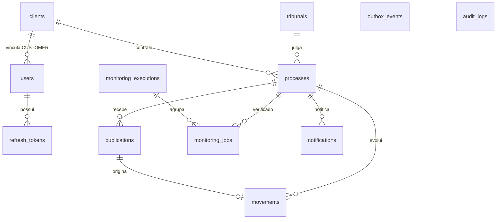

# Monitor Judicial Inteligente — Documento de Arquitetura

> Versão 1 · MVP · Java 21 + Spring Boot 3.5 + Vue 3 + PostgreSQL 17
> Este documento segue a ordem exigida pelo prompt mestre (15 seções). Decisões relevantes estão registradas como ADRs em [`docs/adr`](adr/).

---

## 1. Análise Arquitetural

### 1.1 Problema

Escritórios e departamentos jurídicos precisam saber, todos os dias, se algo mudou nos processos de seus clientes. Hoje isso é feito manualmente, consultando o DJEN (Diário de Justiça Eletrônico Nacional) e os sistemas de cada tribunal. O Monitor Judicial automatiza o ciclo **consultar → detectar → registrar → notificar**.

### 1.2 Requisitos funcionais (MVP)

| # | Requisito | Fase do PDF |
|---|---|---|
| RF01 | Cadastrar, listar, alterar e inativar clientes (CPF/CNPJ validados) | 1 |
| RF02 | Cadastrar processos pelo número CNJ, com validação de dígito verificador e derivação automática do tribunal | 2 |
| RF03 | Consultar o DJEN diariamente (agendado) e sob demanda | 3 |
| RF04 | Detectar publicações novas (deduplicação por hash) | 4 |
| RF05 | Comparar com publicações anteriores (republicação/retificação vs. novidade) | 5 |
| RF06 | Classificar a evolução processual (sentença, decisão, despacho, intimação, citação, edital) | 6 |
| RF07 | Gerar evento de monitoramento de forma confiável (outbox) | 7 |
| RF08 | Notificar o cliente por e-mail e WhatsApp | 8 |
| RF09 | Registrar histórico completo (execuções, jobs, notificações, auditoria) | 9 |
| RF10 | Exibir dashboard com indicadores e séries temporais | 10 |
| RF11 | Autenticação JWT com refresh token, perfis ADMIN / MANAGER / CUSTOMER | Segurança |

### 1.3 Requisitos não funcionais

| Atributo | Meta MVP | Como |
|---|---|---|
| Confiabilidade | Nenhum evento detectado pode ser perdido | Transactional Outbox + fila durável + DLQ (ADR-0004) |
| Idempotência | Reexecutar o monitoramento não duplica publicações nem notificações | `UNIQUE(process_id, publication_hash)` e `UNIQUE(event_id, channel)` |
| Escalabilidade | 10 mil processos por execução em < 30 min | Virtual Threads com concorrência limitada por semáforo (ADR-0005) |
| Disponibilidade do agendador | Uma única execução por janela, mesmo com N réplicas | `pg_try_advisory_lock` (ADR-0006) |
| Segurança | OWASP ASVS nível 2 nos pontos de autenticação | JWT curto + refresh rotativo com detecção de reuso, BCrypt, rate limit em Redis |
| Observabilidade | Rastrear uma publicação do DJEN até a notificação | Correlation ID propagado em HTTP, logs e mensagens; OpenTelemetry |
| Manutenibilidade | Fronteiras de módulo verificadas automaticamente | ArchUnit no build |
| Qualidade | ≥ 90 % de cobertura de linhas no backend | JaCoCo com verificação no CI |

### 1.4 Estilo arquitetural

**Monólito modular** com **Arquitetura Limpa / Hexagonal** dentro de cada módulo (ADR-0001). O PDF pede módulos com fronteiras claras (`clients`, `processes`, `monitoring`…), mas o volume do MVP não justifica o custo operacional de microsserviços. O monólito modular entrega:

- um deploy, uma transação local (fundamental para o outbox);
- fronteiras explícitas (cada módulo expõe apenas o pacote `api`), verificadas por ArchUnit — a extração futura de um módulo para serviço é mecânica;
- RabbitMQ já presente no fluxo de notificação, que é o primeiro candidato natural a se tornar serviço independente.

Fluxo de dependências obrigatório (PDF), aplicado em todos os módulos:



### 1.5 Contexto (C4 nível 1)



### 1.6 Contêineres (C4 nível 2)



---

## 2. Riscos e Premissas

### 2.1 Questionamentos ao escopo do PDF

O prompt pede rigor e questionamento. Estes pontos do PDF foram **alterados** ou **complementados**, com justificativa:

| # | O PDF diz | Problema | Decisão |
|---|---|---|---|
| Q1 | `POST /api/v1/monitoring/run` e `POST /api/v1/notifications/send` | Violam o padrão de API do PJe exigido pelo próprio PDF: *"URLs sem verbos"*, *"substantivos no plural"* | `POST /api/v1/monitoring-executions` (cria uma execução, `202 Accepted`) e `POST /api/v1/notifications` (criar uma notificação é enviá-la). ADR-0003 |
| Q2 | "Comparar movimentações entre publicações do DJEN e tramitações do PJe" | **Não existe API pública de tramitação do PJe.** A consulta processual do PJe é feita via MNI (SOAP, credenciado por tribunal) ou pela consulta pública web (sem contrato, sujeita a captcha) | No MVP, movimentações são **derivadas das publicações do DJEN**. A porta `CourtMovementSource` fica definida para receber o adapter MNI na fase 2, sem tocar no domínio. ADR-0007 |
| Q3 | Plataforma **SaaS** | O modelo de dados do PDF não tem tenant. Sem isolamento, um vazamento entre escritórios é questão de tempo | MVP **single-tenant por implantação** (premissa P1). Todas as tabelas de negócio recebem `tenant_id` na fase 2 com Row-Level Security do PostgreSQL. ADR-0008 |
| Q4 | `monitoring_jobs` com `process_id` | Sem agrupamento por execução, não dá para responder "o que a execução das 06:00 encontrou?" | Nova tabela `monitoring_executions`; `monitoring_jobs.execution_id` |
| Q5 | `publications.publication_hash` | O hash do DJEN identifica a *comunicação*, não o *conteúdo*. Retificações e republicações geram hash novo com o mesmo texto e disparariam notificação falsa | Dois identificadores: `publication_hash` (DJEN, deduplicação) e `content_fingerprint` (SHA-256 do texto normalizado, detecção de republicação) |
| Q6 | Perfil `CUSTOMER` | O modelo não liga usuário a cliente — o CUSTOMER veria tudo | `users.client_id`; consultas de CUSTOMER são filtradas pelo cliente vinculado |
| Q7 | "Disparar mensageria" após "persistir evento" | Publicar no RabbitMQ após o commit perde eventos se o processo cair entre os dois passos (dual write) | Transactional Outbox. ADR-0004 |
| Q8 | Notificações sem preferência | Cliente sem WhatsApp gera falha certa a cada evento | `clients.notify_email` / `clients.notify_whatsapp` |

### 2.2 Riscos técnicos

| # | Risco | Prob. | Impacto | Mitigação |
|---|---|---|---|---|
| R1 | Contrato da API DJEN mudar ou divergir do assumido (o Swagger não pôde ser lido do ambiente de desenvolvimento por política de rede) | Média | Alto | Adapter único (`djen`), caminhos configuráveis em `application.yml`, testes de contrato com WireMock baseados em fixtures; validar fixtures contra o Swagger antes do go-live |
| R2 | Rate limit / indisponibilidade do DJEN | Alta | Médio | Concorrência limitada (semáforo), retry com backoff respeitando `Retry-After`, job marcado `FAILED` e reprocessado na próxima execução (janela de datas cobre o atraso) |
| R3 | Volume: a busca por processo é 1 requisição/processo/dia | Média | Médio | Fase 2: busca por OAB/tribunal/caderno diário (`downloadJournal`) e cruzamento local |
| R4 | Dados pessoais (CPF, telefone, conteúdo de publicações) — LGPD | Alta | Alto | Auditoria completa, mascaramento de documento em logs, TLS, segregação por perfil; base legal: execução de contrato; política de retenção a definir com o DPO |
| R5 | Entregabilidade WhatsApp (templates aprovados pela Meta, janela de 24 h) | Alta | Médio | Envio via template; falha registrada com motivo e visível no painel; e-mail como canal padrão |
| R6 | Execução duplicada do agendador em múltiplas réplicas | Média | Alto | Advisory lock no PostgreSQL |
| R7 | Classificação de movimentação por texto livre | Média | Baixo | Classificação primeiro por `tipoDocumento`/`tipoComunicacao` estruturados do DJEN; texto só como fallback; tipo `OUTROS` explícito |

### 2.3 Premissas

- **P1** Uma implantação por escritório no MVP (single-tenant).
- **P2** Escopo inicial: **Justiça Estadual** (segmento `J = 8` do número CNJ), 27 Tribunais de Justiça.
- **P3** A API de consulta de comunicações do DJEN é pública e não exige autenticação; autenticação é exigida apenas para tribunais que *publicam*.
- **P4** A janela de consulta vai de `last_checked_at` (ou 30 dias antes do cadastro na primeira execução) até hoje.
- **P5** Fuso horário de negócio: `America/Sao_Paulo`. Datas persistidas em UTC (`timestamptz`).

### 2.4 Dependências externas

| Dependência | Uso | Contrato | Falha |
|---|---|---|---|
| API DJEN (`comunicaapi.pje.jus.br`) | Comunicações, tribunais, certidões, cadernos | REST/JSON público | Job `FAILED`, retry na próxima execução |
| SMTP | E-mail | SMTP/TLS | Notificação `FAILED`, retentativa pela fila |
| WhatsApp Cloud API (Meta) | WhatsApp | REST, token Bearer | Idem |
| PJe / MNI | Tramitação (fase 2) | SOAP MNI 2.2 | — |

---

## 3. Modelo de Domínio

### 3.1 Contextos delimitados



`djen` é uma **Anti-Corruption Layer**: o vocabulário do DJEN (`siglaTribunal`, `data_disponibilizacao`, `tipoComunicacao`) não atravessa para o domínio.

### 3.2 Agregados e invariantes

| Agregado | Raiz | Invariantes |
|---|---|---|
| Cliente | `Client` | Documento CPF/CNPJ válido e único; e-mail válido; ao menos um canal de notificação habilitado com contato preenchido |
| Processo | `Process` | `ProcessNumber` CNJ com dígito verificador válido (ISO 7064 mod 97-10); único; tribunal derivado do número (`J.TR`) e ativo; só processos `ACTIVE` são monitorados |
| Tribunal | `Tribunal` | Código único (`TJSP`); UF válida |
| Publicação | `Publication` | Única por `(processo, publication_hash)`; imutável após gravada (exceto `read_at`) |
| Execução de monitoramento | `MonitoringExecution` | Uma `RUNNING` por vez; contém `MonitoringJob` por processo |
| Notificação | `Notification` | Única por `(evento, canal)`; transições `PENDING → SENT | FAILED`, `FAILED → SENT` (reenvio) |
| Usuário | `User` | E-mail único; `CUSTOMER` exige `client_id` |

### 3.3 Objetos de valor

`ProcessNumber`, `Document` (CPF/CNPJ), `Email`, `Phone` (E.164), `ContentFingerprint`, `CourtCode`.

### 3.4 Serviços de domínio

- `PublicationComparisonService` — dada a publicação candidata e o histórico do processo, decide `NEW`, `DUPLICATE` (mesmo hash) ou `REPUBLICATION` (mesmo fingerprint, hash diferente).
- `MovementClassifier` — mapeia tipo de documento/comunicação para `MovementType`.
- `CnjCourtResolver` — `J.TR` → código do tribunal.

### 3.5 Eventos de domínio

| Evento | Produzido por | Consumido por | Transporte |
|---|---|---|---|
| `ProcessEvolutionDetected` | monitoring | notifications | Outbox → RabbitMQ |
| `AuditableActionPerformed` | todos | audit | Evento Spring síncrono, mesma transação |

### 3.6 Diagrama de classes (núcleo)



---

## 4. Casos de Uso

| UC | Ator | Fluxo principal | Exceções |
|---|---|---|---|
| UC01 Autenticar | Todos | `POST /tokens` com e-mail/senha → access (15 min) + refresh (7 dias) | 401 credenciais inválidas; 429 após 10 tentativas/min por IP |
| UC02 Renovar sessão | Todos | `POST /tokens` com `grantType=REFRESH_TOKEN` → novo par; o refresh anterior é revogado | Reuso de refresh revogado → revoga toda a família (roubo de token) |
| UC03 Cadastrar cliente | ADMIN, MANAGER | Valida documento, unicidade, canais → grava → audita | 409 documento duplicado; 422 regra de canal |
| UC04 Cadastrar processo | ADMIN, MANAGER | Valida CNJ e dígito → deriva tribunal → verifica cliente ativo → grava `ACTIVE` | 422 número inválido / tribunal fora do escopo; 409 duplicado |
| UC05 Executar monitoramento | Agendador (06:00), ADMIN, MANAGER | Adquire lock → cria execução → para cada processo ativo, em paralelo: consulta DJEN → compara → grava publicações/movimentações → outbox → finaliza job | Lock ocupado → 409 (manual) / ignora (agendado); falha DJEN → job `FAILED`, execução segue |
| UC06 Notificar cliente | Sistema (fila) | Consome `ProcessEvolutionDetected` → um `Notification` por canal habilitado → envia → `SENT` | Falha de envio → `FAILED` com motivo; mensagem vai para DLQ após 3 tentativas |
| UC07 Reenviar notificação | ADMIN, MANAGER | `POST /notifications` com processo e canal | 422 canal desabilitado |
| UC08 Consultar publicações | Todos (CUSTOMER: só as suas) | Filtra por processo, período, lidas/não lidas | 404 fora do escopo do CUSTOMER |
| UC09 Marcar publicação como lida | ADMIN, MANAGER | `PATCH /publications/{id}` | — |
| UC10 Ver dashboard | Todos | Indicadores + série de 30 dias + distribuição por tribunal | — |
| UC11 Sincronizar tribunais | ADMIN | `POST /tribunal-synchronizations` → `DjenClient.getTribunals()` → upsert | DJEN indisponível → 502 |
| UC12 Consultar auditoria | ADMIN | Filtro por recurso, ator, período | — |

Sequência do UC05 (núcleo do sistema):



---

## 5. Banco de Dados

PostgreSQL 17, migrações versionadas com Flyway em `backend/apps/api/src/main/resources/db/migration`. Chaves `UUID` geradas pela aplicação (UUIDv7, ordenáveis no tempo → índices B-tree sem fragmentação). Colunas de status como `varchar` + `CHECK` (evolui sem `ALTER TYPE`).



| Tabela | Colunas além do PDF | Índices / restrições |
|---|---|---|
| `clients` | `notify_email`, `notify_whatsapp` | `UNIQUE(document)` |
| `processes` | — | `UNIQUE(process_number)`, `idx(status)`, `idx(client_id)`, FK `court_code → tribunals.code` |
| `tribunals` | — | `UNIQUE(code)` |
| `publications` | `content_fingerprint`, `djen_id`, `communication_type`, `document_type`, `organ_name`, `read_at` | `UNIQUE(process_id, publication_hash)`, `idx(process_id, content_fingerprint)`, `idx(publication_date)` |
| `movements` | `publication_id` | `idx(process_id, movement_date desc)` |
| `notifications` | `event_id`, `client_id`, `recipient`, `message`, `error_message`, `attempts`, `created_at` | `UNIQUE(event_id, channel)`, `idx(created_at)` |
| `monitoring_executions` | tabela nova (Q4) | `idx(started_at desc)` |
| `monitoring_jobs` | `execution_id`, `new_publications`, `error_message` | `idx(execution_id)` |
| `outbox_events` | tabela nova (Q7) | índice parcial `WHERE published_at IS NULL` |
| `users`, `refresh_tokens` | autenticação | `UNIQUE(email)`, `UNIQUE(token_hash)` |
| `audit_logs` | `details jsonb`, `correlation_id` | `idx(resource_type, resource_id)`, `idx(occurred_at desc)` |

**Estratégia de persistência:** entidades JPA vivem **somente** em `infrastructure.persistence` e são convertidas para o modelo de domínio com MapStruct. O domínio não conhece JPA (ADR-0002). Consultas de leitura do dashboard usam `JdbcClient` (lado de consulta, sem hidratar agregados).

---

## 6. APIs REST

Base `/api/v1`, JSON, padrões PJe (recursos no plural, sem verbos, sem expor estrutura de banco). Erros em **RFC 9457 Problem Details**. Paginação `?page=0&size=20&sort=campo,asc` com envelope `{content, page, size, totalElements, totalPages}`. Contrato completo em [`docs/openapi/openapi.yaml`](openapi/openapi.yaml), gerado pelos testes.

| Recurso | Métodos | Perfis |
|---|---|---|
| `/tokens` | `POST` (login e refresh) | público |
| `/token-revocations` | `POST` (logout) | autenticado |
| `/users` · `/users/{id}` · `/users/me` | `GET`, `POST` | ADMIN (`/me`: todos) |
| `/clients` · `/clients/{id}` | `GET`, `POST`, `PUT`, `DELETE` (inativa) | ADMIN, MANAGER |
| `/processes` · `/processes/{id}` | `GET`, `POST`, `PUT`, `DELETE` (arquiva) | escrita: ADMIN, MANAGER · leitura: todos (CUSTOMER filtrado) |
| `/processes/{id}/movements` | `GET` | todos (filtrado) |
| `/tribunals` · `/tribunals/{code}` | `GET`, `PATCH` | leitura: todos · escrita: ADMIN |
| `/tribunal-synchronizations` | `POST` | ADMIN |
| `/monitoring-executions` · `/{id}` | `GET`, `POST` (`202`) | ADMIN, MANAGER |
| `/publications` · `/publications/{id}` | `GET`, `PATCH` (lida) | leitura: todos (filtrado) · `PATCH`: ADMIN, MANAGER |
| `/notifications` | `GET`, `POST` (envio manual) | leitura: todos (filtrado) · envio: ADMIN, MANAGER |
| `/dashboard-summary` | `GET` | todos (filtrado) |
| `/audit-logs` | `GET` | ADMIN |

Exemplo de erro:

```json
{
  "type": "https://monitorjudicial.app/problems/invalid-process-number",
  "title": "Número de processo inválido",
  "status": 422,
  "detail": "O dígito verificador 57 não confere; o esperado é 56.",
  "instance": "/api/v1/processes",
  "correlationId": "4f1c8e1a-…"
}
```

---

## 7. Arquitetura Monorepo

```
monitor-judicial/
├── backend/                     Gradle multi-projeto (Kotlin DSL)
│   ├── apps/api                 Spring Boot app: composição, Flyway, segurança HTTP, testes de integração
│   ├── modules/
│   │   ├── authentication       usuários, JWT, refresh, rate limit
│   │   ├── clients
│   │   ├── tribunals
│   │   ├── processes
│   │   ├── monitoring           publicações, movimentações, execuções, outbox
│   │   ├── djen                 ACL + OpenFeign
│   │   ├── notifications        RabbitMQ consumer, e-mail, WhatsApp
│   │   ├── audit
│   │   └── dashboard            consultas de leitura
│   ├── shared                   kernel compartilhado: erros, paginação, correlation id, auditoria, usuário corrente
│   └── buildSrc                 plugins de convenção Gradle
├── frontend/                    Vue 3 + Vite + TS
│   └── src/{features,shared,layouts,router,stores}
├── docs/                        este documento, ADRs, OpenAPI
├── docker/                      Dockerfiles e docker-compose
├── scripts/                     utilitários de desenvolvimento
└── infra/                       Prometheus, Grafana, OpenTelemetry Collector
```

Cada módulo tem a mesma estrutura de pacotes:

```
br.com.monitorjudicial.<módulo>
├── api             contrato público do módulo (interfaces + records) — único pacote visível a outros módulos
├── domain          modelo, objetos de valor, serviços de domínio
│   └── port        portas de saída (repositórios, gateways)
├── application     serviços de aplicação (casos de uso), comandos e DTOs (records)
├── infrastructure  adapters: JPA, Feign, RabbitMQ, SMTP
└── web             controllers REST, requests/responses
```

Regras verificadas por ArchUnit (`ArchitectureTest`): `domain` não depende de Spring Web, JPA nem de `infrastructure`; `web` não acessa `infrastructure`; um módulo só acessa o pacote `api` de outro; sem ciclos entre módulos.

---

## 8. Backend

- **Java 21**: records para DTOs, comandos e eventos; `sealed` para resultados de comparação; pattern matching em `switch`; **Virtual Threads** (`spring.threads.virtual.enabled=true`) para Tomcat e para o fan-out do monitoramento.
- **Spring Boot 3.5**: Web, Security, Data JPA, Validation, Scheduling, AMQP, Mail, Cache (Redis), Actuator.
- **OpenFeign** (Spring Cloud 2025.0) no adapter DJEN com `ErrorDecoder` que traduz `429/5xx` em `RetryableException` e respeita `Retry-After`.
- **MapStruct** para entidade ↔ domínio ↔ DTO; **Lombok** só em entidades JPA e na injeção (`@RequiredArgsConstructor`). Domínio sem Lombok.
- **Flyway** para o esquema; `ddl-auto=validate`.
- **Monitoramento**: `MonitoringScheduler` (cron configurável, `America/Sao_Paulo`) → `RunMonitoringService` → um `MonitoringJob` por processo em Virtual Thread, limitado por `Semaphore(monitoring.max-concurrency)`. Cada processo é uma transação própria (falha isolada).
- **Outbox relay**: `@Scheduled(fixedDelay)` lê `outbox_events` pendentes com `FOR UPDATE SKIP LOCKED`, publica com *publisher confirms* e marca `published_at`.
- **Notificações**: `@RabbitListener` idempotente; `NotificationSender` (porta) com adapters `EmailNotificationSender` (Spring Mail) e `WhatsAppNotificationSender` (Cloud API via Feign). Sem credenciais de WhatsApp, o adapter registra `FAILED` com motivo explícito — nunca finge sucesso.

## 9. Frontend

- Vue 3 Composition API + TypeScript estrito, Vite, Pinia, Vue Router, Axios, VueUse, Tailwind CSS v4, componentes no padrão ShadCN Vue (reka-ui + class-variance-authority), ECharts.
- Os componentes base (`Button`, `Card`, `Input`, `Modal`…) foram escritos no padrão do ShadCN Vue em `shared/ui`, em vez de gerados pela CLI, para usar diretamente os tokens do design system.
- **Design system Monitor Judicial** (tokens de cor, tipografia, raio) mapeado para as variáveis do ShadCN em `src/shared/styles/tokens.css`.
- Organização **por feature** (`features/auth`, `features/dashboard`, `features/clients`, `features/processes`, `features/notifications`, `features/publications`), cada uma com `api.ts`, `store.ts`, `views/`, `components/`.
- `shared/api/http.ts`: instância Axios com interceptors de JWT, renovação automática por refresh token (fila de requisições durante o refresh) e `X-Correlation-Id`.
- Guardas de rota por perfil; o frontend nunca fala com o banco (regra do PDF), apenas com a API.

## 10. Infraestrutura

- `docker/docker-compose.yml`: PostgreSQL 17, Redis 7, RabbitMQ 4 (management), Mailpit (SMTP de desenvolvimento), API, frontend (nginx), Prometheus, Grafana, Jaeger (OTLP).
- Imagem da API: build multi-stage, JRE 21, usuário não-root, `-XX:MaxRAMPercentage=75`.
- CI GitHub Actions: build + testes + cobertura do backend (Testcontainers no runner), lint + testes + build do frontend, build das imagens.
- Configuração 12-factor por variáveis de ambiente; segredos nunca no repositório.

## 11. Segurança

| Controle | Implementação |
|---|---|
| Autenticação | JWT HS256 *stateless*, access token de 15 min. Fase 2: RS256 + JWKS (ADR-0009) |
| Refresh token | Opaco (256 bits), armazenado **somente como hash SHA-256**, 7 dias, **rotação a cada uso** e **detecção de reuso** (revoga a família inteira) |
| Senhas | BCrypt custo 12 |
| Autorização | RBAC por `@PreAuthorize` nos controllers + escopo de dados para CUSTOMER nos serviços de consulta |
| Rate limiting | Janela fixa em Redis: 10 req/min por IP em `/tokens`, 300 req/min por usuário nas demais rotas; `429` com `Retry-After` |
| Auditoria | Toda escrita gera `audit_logs` (ator, ação, recurso, correlação, detalhes) na mesma transação |
| Transporte e cabeçalhos | HTTPS no proxy; HSTS, `X-Content-Type-Options`, `frame-ancestors 'none'`; CORS restrito à origem do frontend |
| Dados pessoais | Documento mascarado em logs; erros nunca expõem SQL ou stack trace |

## 12. Observabilidade

- **Métricas** (Micrometer → Prometheus): `monitoring.execution.duration`, `monitoring.publications.new`, `djen.requests` (por status), `notifications.sent` (por canal e status), `outbox.pending`, além de JVM/HTTP/HikariCP.
- **Tracing** (Micrometer Tracing → OpenTelemetry → Jaeger): spans do agendador, chamadas DJEN, publicação e consumo RabbitMQ.
- **Correlation ID**: filtro aceita/gera `X-Correlation-Id`, grava no MDC, devolve no response e no Problem Details e propaga no cabeçalho AMQP.
- **Logs estruturados** em JSON (formato ECS nativo do Spring Boot 3.5).
- **Grafana**: dashboard provisionado "Monitor Judicial" (execuções, novidades/dia, latência DJEN, notificações por status).

## 13. Estratégia de Testes

| Camada | Ferramenta | Escopo |
|---|---|---|
| Domínio | JUnit 5 | Objetos de valor (CNJ, CPF/CNPJ), comparação, classificação — sem Spring |
| Aplicação | JUnit 5 + Mockito | Casos de uso com portas mockadas |
| Adapters | Testcontainers (PostgreSQL, Redis, RabbitMQ) + WireMock (DJEN) | Repositórios, Feign, mensageria |
| API | `@SpringBootTest` + MockMvc + Testcontainers | Contratos HTTP, segurança, RBAC, fluxo ponta a ponta |
| Arquitetura | ArchUnit | Regras da seção 7 |
| Frontend | Vitest + Vue Test Utils | Stores, componentes, interceptors |

Meta de cobertura: **≥ 90 % de linhas** no backend, verificada pelo JaCoCo (`./gradlew check`), excluindo classes de configuração, entidades JPA e DTOs de requisição.

Resultado na entrega: 160 testes no backend, **96,3 % de linhas** e 80,6 % de ramos; 24 testes no frontend.

## 14. Roadmap MVP

| Sprint | Entregas | Fases do PDF |
|---|---|---|
| 0 | Monorepo, CI, Docker, autenticação, auditoria | — |
| 1 | Clientes, tribunais, processos | 1, 2 |
| 2 | Adapter DJEN, execução de monitoramento, detecção e comparação | 3, 4, 5, 6 |
| 3 | Outbox, RabbitMQ, notificações e-mail/WhatsApp | 7, 8 |
| 4 | Histórico, dashboard, observabilidade | 9, 10 |
| Fase 2 | Multi-tenant (RLS), MNI/PJe, busca por OAB e caderno, digest diário, RS256 | — |

## 15. Código

O código está neste repositório. Veja o [`README.md`](../README.md) para executar.
